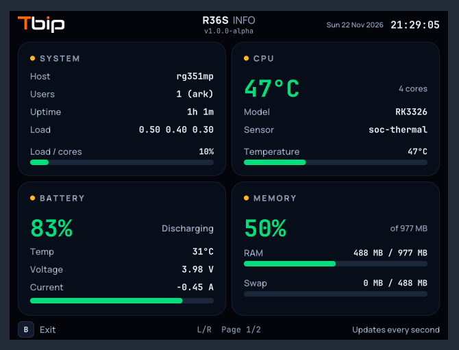
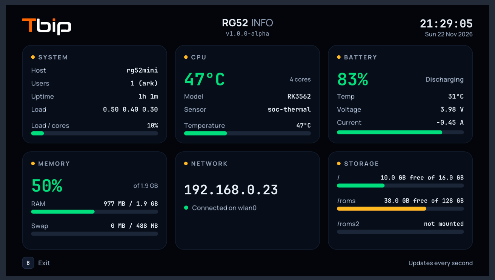

<p align="left">
  <picture>
    <source media="(prefers-color-scheme: dark)" srcset="docs/tbip-light.svg">
    <source media="(prefers-color-scheme: light)" srcset="docs/tbip-dark.svg">
    
  </picture>
</p>

<p align="left"><strong>Turning Bits Into Products</strong></p>

# system-info

Mostra as informações do sistema em aparelhos compatíveis com o dArkOS, no mesmo
visual do `led-rgb`. Substitui o `System Info.sh` (que usa `msgbox`): mesmas informações, em
cartões com barras de uso, atualizando a cada segundo.

| Cartão | Conteúdo |
|---|---|
| System | host, usuários logados, uptime, load (1/5/15 min) e load ÷ núcleos |
| CPU | temperatura, modelo, sensor térmico |
| Battery | carga, status, temperatura, tensão (V) e corrente (A) |
| Memory | RAM e swap (usado / total) |
| Network | interface e endereço IPv4 |
| Storage | `/`, `/roms`, `/roms2` (livre / total, uso) |

Barras ficam verdes até 60 %, âmbar até 85 % e vermelhas acima; a bateria fica âmbar abaixo de 30 % e
vermelha abaixo de 15 %.

Diferenças em relação ao script: tensão e corrente aparecem em **V e A** (o script dividia por 10⁶ mas
rotulava "μV/μA"); as zonas térmicas são escolhidas pelo **nome** (`cpu`/`soc`, `battery`), caindo nos
índices 1 e 0 do script se não houver nome; qualquer arquivo ausente vira "-" em vez de quebrar a tela.
Só lê `/proc`, `/sys` e `statvfs`: **não precisa de root** nem executa comandos.

| R36S | RG52 Mini |
|---|---|
|  |  |

## Aparelhos

O app funciona em **qualquer aparelho**, porque só lê `/proc` e `/sys`. Em 16:9 mostra os seis cartões; em 4:3 e 3:2 divide em páginas, trocadas com **L/R** ou **esquerda/direita**.

O aparelho é identificado por `--device`, `/home/ark/.config/.DEVICE`, hostname e chip, nesta ordem. Os perfis ficam em `src/devices/`, pasta idêntica em led-rgb, remote-services e system-info. Use `--device ID` (`rg52mini`, `rg43`, `r36s`, `rgb10`, `a10mini`, `rk3566`, `generic`) ou `DEVICE_PROFILE=ID` no script para forçar um perfil.

## Compilar (no aparelho, Debian Trixie arm64)

```bash
sudo apt install cargo libsdl2-dev pkg-config
cargo build --release          # binário: target/release/system-info
```

Sem SDL2 (só biblioteca e testes): `cargo test --no-default-features`.
Compatível com rustc antigo (`rust-version = "1.80"`, sem APIs novas da std).

## Instalar no menu Tools

1. Copie `scripts/System Info.sh` para a pasta dos scripts do menu Tools (onde está o `LED Settings.sh`)
   e dê `chmod +x`.
2. Copie o binário `system-info` para `system-info/system-info` ao lado do `.sh` (ou só ao lado, ou
   `/opt/system-info/system-info`).
3. Reabra o menu: aparece "System Info". Se falhar, a tela mostra o fim de `/tmp/system-info.log`.

Variáveis do script: `ACCENT=teal` (amber, teal, violet, coral ou `#RRGGBB`), `USE_GPTOKEYB=1` (usa o
gptokeyb e passa `--no-gamepad`), `SDL_VIDEODRIVER=kmsdrm` (só se a tela ficar preta).

## Usar

```bash
./system-info --fullscreen            # no aparelho; B / A / Start / Esc / Enter saem
./system-info --screenshot tela.ppm   # PC: desenha um quadro 1280x720 sem janela
```

Opções: `--fullscreen`, `--no-gamepad`, `--interval S`, `--accent COR`, `--root PATH` (lê `/proc` e `/sys`
de outra raiz), `--screenshot`.

## Estrutura

```
src/sysinfo.rs  coleta (parsers puros + leitura de /proc, /sys, statvfs, getifaddrs) e formatação
src/ui.rs       tela 960x540: cartões, barras, cores por nível
src/gfx.rs      rasterizador por software (mesmo do led-rgb)
src/main.rs     laço SDL2 (textura, atualização a cada segundo)
assets/fonts/   Manrope e JetBrains Mono (subsets ASCII, SIL OFL)
scripts/System Info.sh   item do menu Tools
```

## Verificado e não verificado

Verificado em x86_64: parsers e coleta contra uma árvore `/proc`/`/sys` falsa (inclusive tudo
ausente), renderização por pixels (barras, cores, corte de texto longo, letterbox) e execução com dados
reais desta máquina. **Não testado no aparelho:** os caminhos exatos de `/sys/class/thermal` e
`power_supply/battery`, o launcher dentro do EmulationStation e o vídeo KMSDRM.

---

Ferramentas open source para consoles portáteis com dArkOS

A **Tbip** (*Turning Bits Into Products*, ou "transformando bits em produtos") desenvolve ferramentas **open source** para o [dArkOS](https://github.com/christianhaitian/dArkOS), sistema usado em consoles portáteis de jogos. Nosso objetivo é substituir telas de terminal e scripts por interfaces gráficas claras, feitas para usar com os botões do próprio aparelho.

Todas as ferramentas são escritas em **Rust** e usam **SDL2**. Elas identificam o aparelho automaticamente, mostram apenas o que ele possui e adaptam o layout à tela. 


## Open source

Nossos projetos são distribuídos sob a **licença MIT**. Você pode usar, estudar, modificar e redistribuir o código, inclusive em outros projetos, desde que mantenha o aviso de copyright e a licença.
